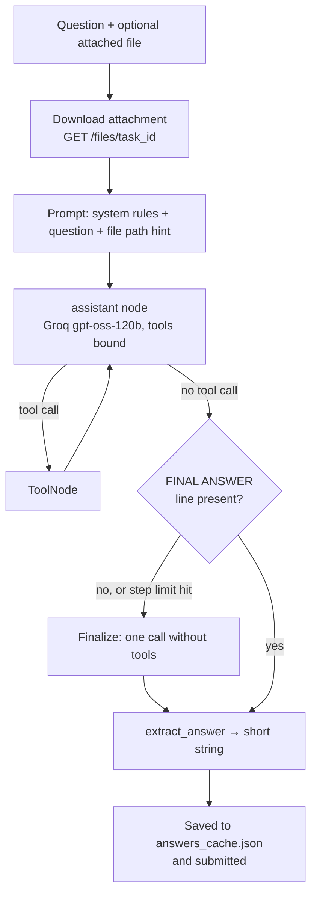

# WikiIT-LangGraph-Showcase
---
title: WikiIT – HF Agents Course Final Assignment
sdk: gradio
sdk_version: 5.25.2
---

# WikiIT – Hugging Face Agents Course, Final Assignment

A tool-using research agent built with **LangGraph** that answers the 20 GAIA Level-1
questions of the [Hugging Face Agents Course](https://huggingface.co/learn/agents-course)
Unit 4 final assignment. It runs as a public Gradio Space, fetches the questions from the
course API, answers them with web search, Wikipedia, file readers, Python execution,
speech-to-text and a vision model, and submits the answers for exact-match grading.

## Results

| Version | What changed | Score |
|---|---|---|
| v0 | Course template, fixed default answer 
| v0.1 | LLM only, no prompt engineering, no tools 
| v0.2 | System prompt with `FINAL ANSWER:` convention + answer extraction
| v1 | LangGraph ReAct loop + Tavily web search 
| v2 | File attachments, 8 tools, saved answers, quota handling 

### Question mix

What the 20 public questions need, and which part of the agent handles it:

| Question type | Count | Handled by |
|---|---|---|
| Web / Wikipedia research (people, dates, counts, sports stats, papers) | 10 | `web_search`, `wikipedia_search`, `read_webpage` (HTML and PDF, with `find=` to zoom in) |
| Pure reasoning puzzles (reversed text, set-theory table, botanical classification) | 3 | the model itself, prompt rules |
| Audio attachments (.mp3) | 2 | `transcribe_audio` (Groq Whisper) |
| Spreadsheet attachment (.xlsx) | 1 | `read_file` + `run_python` (pandas) |
| Python attachment (.py) | 1 | `read_file` + `run_python` |
| Image attachment (.png, a chess position) | 1 | `describe_image` (Groq vision model) |
| YouTube videos | 2 | `youtube_transcript`, with web search as fallback |

Realistic ceiling with this stack: about 14 / 20. The chess image and the two YouTube
questions are the hardest and may stay wrong.

## Architecture

`app.py` has three parts:

| Part | Role |
|---|---|
| `BasicAgent` | Builds the LangGraph graph (`assistant` ⇄ `tools`), downloads attachments, runs the loop, extracts the final answer |
| `run_and_submit_all()` | Course template runner: fetches questions, calls the agent per question, submits. Changed to pass `task_id`/`file_name`, save answers as it goes, and stop early when the Groq daily quota is gone |
| Gradio UI | Login + run button from the template, plus a **test on one random question** button that submits nothing |

### Tools

| Tool | Backed by | Notes |
|---|---|---|
| `web_search` | Tavily (free tier) | 3 results + Tavily's suggested answer, trimmed to ~500 chars each |
| `wikipedia_search` | MediaWiki API | Titles, snippets, URLs; no extra dependency |
| `read_webpage(url, find)` | requests + BeautifulSoup / pypdf | Returns passages around `find` instead of the whole page; tables keep their rows |
| `read_file` | pandas, pypdf, python-docx | xlsx / csv / pdf / docx / py / txt |
| `run_python` | subprocess | Arithmetic, sorting, running the attached .py; 90 s timeout |
| `transcribe_audio` | Groq `whisper-large-v3-turbo` | Free tier |
| `describe_image` | Groq vision model (`GROQ_VISION_MODEL`) | Ask precise questions |
| `youtube_transcript` | youtube-transcript-api + oEmbed | Often blocked from cloud IPs; falls back to title + web search |

### Working within free-tier limits

Every design choice below exists because of Groq's tokens-per-minute (TPM) and
tokens-per-day (TPD) limits:

- Tool results are capped at `MAX_TOOL_CHARS` (3000) characters.
- `max_tokens=1024`: Groq reserves `max_tokens` against TPM, so bigger values trigger 413 "request too large".
- `RECURSION_LIMIT=16` graph steps per question (8 tool rounds at most).
- 429 errors: the wait time is parsed from Groq's message and the call is retried.
- 413 errors: older tool results are replaced by a stub and the call is retried.
- TPD exhausted: the run stops immediately, remaining questions are marked skipped.
- Answers are saved to `answers_cache.json` after each question, so the next run only redoes what is missing.
- `PAUSE_BETWEEN_QUESTIONS=20` seconds between questions.

## Lessons learned

- **Format is half the score.** Exact-match grading means `Paris` passes and `The answer is Paris.` fails. A strict `FINAL ANSWER:` convention plus a tolerant extractor (bold markers, quotes, trailing periods) moved the score from 10 % to 20 % before any tool existed.
- **The runner only passes the question text.** Attached files are invisible unless you also pass `task_id` and download from `/files/{task_id}`. Five of the twenty questions depend on a file.
- **Free tiers fail in slow motion.** A quota cutoff looked like a broken agent (5 % re-run). Saving answers as they are produced and detecting the "per day" error turned that into a resumable run.
- **Whole web pages do not fit.** A Wikipedia article is 50k+ characters; a `find=` keyword that returns only the surrounding passages fits in the per-minute budget and reads better for the model.
- **One change per run.** With a 20-question benchmark, you cannot tell what moved the score otherwise.
- **Build-cache gotcha.** New packages never installed because `requirements.txt` had not changed; editing it forces a rebuild.

## Roadmap

- [ ] Run v2 and record the score and run metrics above
- [ ] Better handling of the chess image (board → FEN → engine)
- [ ] YouTube fallback via audio download + Whisper where captions are blocked
- [ ] Try a higher-TPD model as the default once limits are confirmed in the Groq console

## Acknowledgements

Built for the [Hugging Face Agents Course](https://huggingface.co/learn/agents-course).
Questions come from the [GAIA benchmark](https://huggingface.co/gaia-benchmark) (Level 1).
